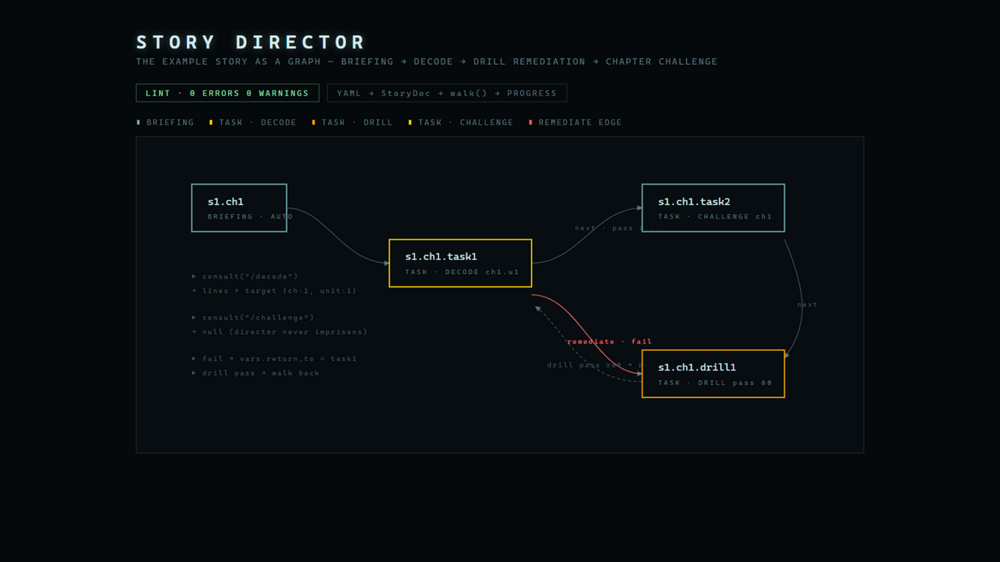

<div align="center">

# story-director

**节点图剧情导演引擎 —— 旁路接管层：把你的命令流拿到剧情图上咨询，永不监禁用户。YAML 是唯一契约：AI 产线离线生成、人工审阅 diff、lint 把关发布。**

[](./LICENSE)
[](./.github/workflows/ci.yml)

[English](./README.md)

</div>

---

> ▶ **在线演示：[www.hackerenglish.com](https://www.hackerenglish.com)** —— 终端里的特工剧情正由本引擎导演。

大多数叙事引擎会接管整个应用：玩家活在剧情里。StoryDirector 反过来——它坐在你现有命令流**旁边**：用户执行动作时先问导演；命中当前剧情节点，返回叙事台词和可选目标；否则返回 `null`，你的应用照常自由运行。
<div align="center">
  
</div>
剧情节点负责调度玩家、权限门负责查通行证，但**没有人会被困住**：与本节点无关的命令永远按自由行为执行。

```ts
import { consult, walk, onUnitDone } from "story-director";

// 用户敲了命令——先问导演
const directive = consult(graph, progress, "/decode", holdsPass);
if (directive) {
  pushLines(directive.lines);           // 叙事台词
  if (directive.target) startTask(directive.target);
} else {
  runFreeCommand(cmd);                  // 导演不感兴趣，走自由行为
}
```

## 设计原则

- **导演永不监禁用户** —— 咨询是旁路的；不匹配的命令总是回落到自由行为。
- **节点 ID 跨版本稳定** —— 进度按 id 存储（`s1.ch1.u1`），发布新版本剧本不会作废玩家进度。
- **图是数据，编辑器可插拔** —— 管理台表单、可视化编辑器、AI 生成管线读写同一份 `StoryDoc`；YAML 导入导出让"离线生成 → 人审 diff → lint → 上线"成为流水线。
- **纯逻辑** —— consult/walk/迁移函数零副作用；持久化和台词投递留在你的应用里（DB 层是你的接缝）。

## 节点词表（固定在代码里）

| 类型 | 行为 |
| --- | --- |
| `briefing` | 开场说明，`walk()` 自动通过 |
| `task` | 停住 —— 玩家必须完成 `payload.action`（`decode` / `challenge` / `drill`） |
| `hook` | 悬念钩子，自动通过 |
| `gate` | 未持有 `payload.sku` 时停住 |
| `reward` | 奖励节点，自动通过 |
| `checkpoint` | 存档节点，自动通过 |

进度迁移：`onUnitDone`（通过 → `next`；失败 → `remediate`，并在 `vars.return_to` 记住返回点）、`onChallengeDone`、`onDrillDone`（达标回到补救来源）、`onUnitQuit`（只回台词不改进度）。

## 安装

```bash
npm install story-director
npm install js-yaml   # 可选 peer，仅 YAML 入口需要
```

| 部分 | 导入 |
| --- | --- |
| 导演核心（零依赖） | `"story-director"` |
| YAML + 校验器 | `"story-director/yaml"` |

## YAML 工作流

```ts
import { storyDocFromYaml, lintStoryDoc, storyDocToYaml } from "story-director/yaml";
import { graphFromSeed } from "story-director";

const doc = storyDocFromYaml(yamlText);
const { errors, warnings } = lintStoryDoc(doc); // 悬空边、孤立节点、双语纪律……
if (errors.length === 0) {
  const graph = graphFromSeed({ season: doc.season, version: doc.version, nodes: doc.nodes });
}
```

完整示例剧本见 [`docs/example/story.yaml`](./docs/example/story.yaml)：
开场简报 → 解码任务 → 训练补救 → 章节挑战。

## 校验器检查项

- 必备结构（`season`、`version.entry`、非空 `nodes`）
- 重复 id、`next`/`remediate` 悬空引用
- task 节点必须声明 `action`（decode/challenge 还需 `chapter`）
- 双语纪律：每条 task 台词必须同时有 `zh` 和 `en`
- 从入口的可达性（孤立节点给 warning）
- gate 节点缺 `sku` 时默认按 `any_pass` 处理

## 来源

抽取自 HackerEnglish 项目——它在一套英语学习终端里导演着完整的特工剧情。三轮设计讨论的记录在原项目 docs 中。见 [`docs/PORTING.md`](./docs/PORTING.md)。

## 许可

[MIT](./LICENSE)。
